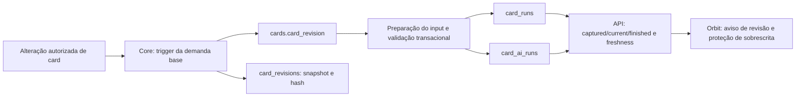

# Implementação 02 — Versionamento da demanda base dos cartões

Data: 2026-11-13. Goal separado criado por autorização explícita do responsável após a etapa 01. Escopo: código, projeções, contratos e testes isolados; sem ativação em bancos reais.

## 1. Resumo executivo

Implementado o versionamento monotônico da demanda base no core, independente do plugin IA. Cada card tem `card_revision`; alterações relevantes produzem snapshots imutáveis com SHA-256 em `card_revisions`. Runs genéricos e de prompt capturam a revisão do mesmo card usado para preparar o input. Uma revisão que mudou durante a preparação causa conflito, sem atribuir silenciosamente o prompt antigo a uma revisão nova.

Resultados continuam preservados com seu status original. A API e a interface distinguem `pending`, `current`, `stale` e `unversioned`, mostram a revisão capturada/atual e protegem a substituição da descrição com compare-and-swap opcional. A conclusão registra separadamente `finished_card_revision`. Sessões Codex de outra revisão base não são reutilizadas; perguntas antigas precisam ser canceladas antes de uma execução da nova demanda.

Foi resolvido o pré-requisito de publicação do core por meio de seleção transacional de pacote no mecanismo oficial. `@orbit/core-source` passou de 1.3.0 para 1.4.0 e foi projetado nos quatro runtimes em arquivos. Nenhuma UI mapeada foi sobrescrita. Não houve deploy, reinício ou migração nos bancos reais.

**Entrega de implementação: CONCLUÍDA no escopo de código e testes isolados. Ativação operacional: PENDENTE.** O banco de cada ambiente precisa receber a migração 157 antes de carregar o backend novo. A compilação web do Suindá permanece bloqueada por erros sintáticos anteriores em outro arquivo; nove drifts UI continuam pendentes. Esta entrega não declara a plataforma inteira homologada ou todos os gates do monorepo verdes.

## 2. Estado inicial e autorização

Raiz `/home/meada/projetos/orbit`, branch `main`, HEAD `d9307b8e6a54316f802acbd7bcb96baa26116f16`, sem criação de branch/commit. A árvore já continha toda a etapa 01 não commitada: alterações em README de aceleração e catalog/cli/shared, novos preflight/tests/relatório01, relatórios18–20 e ZIP não rastreados. Foram preservados. A autorização atual inicia uma etapa nova; não transforma a etapa01 histórica em entrega integralmente sincronizada retroativamente.

O relatório01 descrevia oito projeções core antigas e nove diferenças independentes de UI. Antes de editar foram conferidos Git, mapas, filas, schema, `main.ts`, prompt sessions, helpers/tests e instruções locais. Trabalho local direto conforme `orbit-environment`; nenhum contexto de card foi fornecido.

## 3. Referências e fronteira escolhida

Os relatórios00–20 e o relatório01 da implementação constituem o contexto já investigado. Influenciaram especialmente: risco de sucesso obsoleto; duas filas preservadas; snapshot global sem isolamento; necessidade de fonte canônica e projeção por hash; IA como provider parcial; proibição de homogeneizar produtos por cópia.

Sem um novo roteiro detalhado anexado para a etapa02, foi adotado o próximo componente explicitamente identificado no handoff: Card Version Manager. A fronteira desta entrega é **revisão da demanda base**, não revisão de todo o contexto do projeto. A numeração é uma revisão inteira monotônica, não SemVer de produto/plugin nem inferência automática de major/minor/patch do pedido.

Campos revisionados: `title`, `description`, `kind`, `target_board_id`, `link_url`, `ai_project_id`, `ai_model`, `ai_effort`, `ai_execution_mode`, `start_date`, `due_date`, `reminder_minutes`, `recurrence`, `schedule_start_at`, `schedule_end_at`, `schedule_all_day`, `schedule_time_zone`.

Ficam fora: posição/lista, conclusão, progresso, timestamps operacionais, checklists, anexos, comentários, vínculos vivos de contexto, configuração independente de execução, defaults de board/projeto/usuário, fontes e checkout/HEAD. Mudanças nesses itens não podem ser declaradas detectadas pela revisão base. O Context Registry/Compiler e o fingerprint completo continuam etapas posteriores.

## 4. Arquitetura e invariantes

O banco aplica os invariantes do core por triggers, cobrindo os caminhos existentes de alteração de cards sem obrigar cada plugin a criar seu próprio contador. O mecanismo de plugins, permissões, workers, filas, providers e Git permanece existente.

1. Card novo começa em r1. Card existente recebe baseline r1 do estado observado na migração, sem inventar estados passados.
2. Alteração do snapshot base incrementa uma vez; noop/posição/conclusão não incrementam. A comparação é de JSON normalizado; timestamps são normalizados em UTC.
3. Snapshot e incremento são transacionais. Rollback da edição também desfaz a revisão.
4. Históricos não podem ser alterados, apagados isoladamente ou inseridos diretamente pelos fluxos da aplicação. Exclusão do card mantém o cascade existente. Proprietário do DB pode alterar triggers; isto não é sandbox contra administrador de banco.
5. Runs novos exigem revisão atual sob `FOR SHARE` no card. Captura e card_id não podem mudar depois. Replays por request-key retornam o run original, sem revinculá-lo à demanda atual.
6. Runs legados permanecem com revisão capturada nula. Nenhuma revisão histórica é deduzida de `updated_at`, prompt ou texto parecido.
7. A revisão observada ao concluir é registrada sem substituir a revisão capturada. `success` continua significando que o executor terminou; freshness expressa a relação com a demanda base.



## 5. Decisões técnicas

- Reaproveitar o mecanismo de fonte/projeção e adicionar seleção transacional de pacote, mantendo o modo global estrito. Não mascarar drift alterando hashes de lock.
- Usar inteiro PostgreSQL positivo, snapshot JSON schema_version1 e SHA-256 local do PostgreSQL, sem provider/embeddings/serviço pago.
- Separar a política de atualidade da política de execução: não cancelar, descartar output ou reclassificar como erro um run que ficou antigo depois de enfileirado.
- Validar revisão na mesma transação de enqueue. Nos prompts, a revisão é lida junto com o conteúdo e revalidada sob lock depois da preparação; no genérico, revisão e conteúdo vêm do mesmo snapshot e são validados antes de inserir.
- Retomar uma pergunta somente se sua revisão ainda corresponde à atual; filtrar também a busca de sessão anterior por revisão. Isso não promete compatibilidade de contexto/HEAD.
- PATCH comum continua compatível sem revisão esperada. A substituição por resultado usa `expected_card_revision`, que aplica CAS atomicamente e retorna409 se houve nova edição.
- Manter migração versionada pelo runner atual. Não alterar migrations existentes nem executar migração em ambiente real nesta entrega.
- Separar limitações globais anteriores dos testes desta mudança. Uma diferença legítima do Safdoulas não foi removida para tornar o checker verde.

## 6. Implementações — fontes e ferramentas

| Arquivo | Mudança, propósito e consumidores |
|---|---|
| `packages/orbit-core/sql/migrations/157_card_revisions.sql` | Nova fonte canônica da migração: baseline, contador, snapshots/hash, proteção de histórico, vínculo/revisão de conclusão das duas filas. Projetada para `apps/api/sql/migrations/` nos quatro runtimes. |
| `packages/orbit-core/src/card-versions.ts` | Tipos, lista explícita de campos, validação/conflito, freshness atual/no término e expressão SQL com aliases validados. Consumida pelos endpoints e pelos testes. |
| `packages/orbit-core/src/card-versions.spec.ts` | Seis testes puros do contrato, limites, SQL aliases, escopo da migração e proveniência de conclusão. |
| `packages/orbit-core/src/execution/run-repository.ts` | Captura revisão no INSERT/input; preserva idempotência antes de validar o estado atual; verifica revisão sob lock antes do novo run. Não substitui claim/finish/quota. |
| `packages/orbit-core/src/execution/execution.service.ts` | Consulta revisão na leitura do card; expõe captured/current/finished/freshness no histórico/detalhe e resultado genérico. Mantém autorização existente e campos públicos anteriores na lista. |
| `packages/orbit-core/src/execution/file-scope.ts` e `.spec.ts` | Conteúdo anterior da fonte canônica foi revisado/testado e projetado pela release. Não houve reimplementação do algoritmo. Exclusões operacionais do monorepo deixam de divergir dos runtimes; rollback global continua sem autoria. |
| `packages/orbit-core/package.json` | Arquivos novos e diretório SQL registrados; versão fonte1.4.0, separada da versão de API do core. |
| `orbit.workspace.json` | Três novos mappings de fonte (helper, spec, migração) e versão1.4.0. |
| `tools/orbit/shared.mjs` | `packageIds`/`--packages` no reconcile; preservação de pacotes não selecionados e suas entradas de lock. Comparação semântica de locks para não classificar apenas ordem de chaves JSON como deriva. |
| `tools/orbit/shared.test.mjs` | Sete casos de release selecionada e um de ordem de chaves, além dos13 anteriores:21 testes. |

A seleção de pacote não amplia escopo de escrita, ignora colisões de ownership ou autoriza operação. Valida estrutura global/locks e precondições; não lê/publica fontes não selecionadas nem sobrescreve suas projeções. Rollback da persistência e hash de precondição permanecem.

## 7. Implementações — quatro runtimes e instruções

Nos quatro prefixos `dev/app`, `prod/app`, `safdoulas/app`, `suinda/app`, foram adaptados os seguintes arquivos não mapeados, por mudanças localizadas que preservam o restante:

| Sufixo | Alteração |
|---|---|
| `apps/api/src/main.ts` | Card do quadro inclui revisão da fonte efetiva (inclusive espelhos); PATCH opcional CAS; endpoint de histórico autorizado e bloqueio para cofre. |
| `apps/api/src/orbit-architecture.ts` | `expected_card_revision` no contrato de PATCH; instrução persistente descreve revisão core, freshness e limites. |
| `apps/api/src/plugins/ai/prompt-sessions.ts` | Leitura/captura/revalidação da revisão, INSERT vinculado, retomada por mesma revisão, busca de sessão compatível com base, campos públicos de atualidade. |
| `apps/api/src/prompt-question.spec.ts` | Fixture realista com revisão e regressões de preparação/resposta antiga, sem usar provider nos testes selecionados. |
| `apps/web/lib/api.ts` | Campos opcionais e helpers de classificação/etiqueta, compatíveis com resultados legados. |
| `apps/web/components/card-dialog.tsx` | Avisos no resumo, refresh por revisão/status e CAS ao substituir descrição; stale/legado/pending não substituem a descrição. O output continua visível. |
| `apps/web/components/prompt-execution.tsx` | Indica a revisão no histórico e resultado exibido, mantendo status e conteúdo. |
| `orbit.shared-lock.json` | Somente entrada core atualizada pela release. Valores/ordem das entradas UI foram preservados. |

As sete projeções core alteradas/criadas por runtime são `apps/api/src/card-versions.ts`, `card-versions.spec.ts`, `execution/execution.service.ts`, `execution/run-repository.ts`, `execution/file-scope.ts`, `execution/file-scope.spec.ts` e `apps/api/sql/migrations/157_card_revisions.sql`.

Instruções foram sincronizadas em `AGENTS.md`, `docs/product-experience.md` e `orbitArchitecturePrompt` dos quatro runtimes. A skill de ambiente não precisou mudar: sua responsabilidade continua distinguir trabalho local de execução por cartão. O README de aceleração descreve a publicação selecionada e este handoff. Não há novo tema, menu, plugin de produto, worker ou regra dependente de IA.

## 8. Contratos de API e dados

`cards.card_revision`: inteiro positivo do estado base. Cliente não escreve esse campo. O endpoint de quadro passa a expô-lo para permitir atualização de indicadores após edição remota.

`GET /cards/:id/revisions`: histórico descendente de até100 snapshots, com `card_id`, `revision`, `snapshot`, `content_hash`, `created_at`. Reutiliza `cardBoard` e autorização de leitura do quadro; não é rota IA. Cofre retorna409. Não há escrita/restauração pela rota nem paginação além desse limite nesta etapa.

`PATCH /cards/:id` aceita `expected_card_revision` opcional (inteiro positivo). A condição faz parte do UPDATE; conflito retorna409 sem sobrescrever. Cliente antigo sem o campo continua com comportamento anterior. Não se promete proteção de edição concorrente para clientes que não enviam CAS.

Históricos de ambas as filas expõem:

- `card_revision`: revisão capturada; nula nos legados.
- `current_card_revision`: revisão base vigente na consulta.
- `finished_card_revision`: revisão observada na transição terminal; nula se a proveniência não existe.
- `freshness`: `unversioned` se falta vínculo; `stale` se difere da atual; `pending` se mesma revisão e queued/running/waiting_answer; `current` se mesma revisão em estado terminal.

Freshness atual pode mudar depois da conclusão. `finishedRevisionFreshness` permite distinguir a atualidade no término da atualidade de hoje. Nenhuma dessas classificações prova merge, integração, contexto completo ou revisão do repositório.

## 9. Projeção e compatibilidade

A release foi primeiro planejada sem escrita, depois aplicada pelo mecanismo oficial com pacote `@orbit/core-source`, release `minor` e atribuição explícita dos caminhos novos/alterados e dos dois file-scope anteriores revisados. Foram34 destinos de publicação, incluindo metadados/workspace, projeções e locks.

Foi comparado o estado de todas as fontes/projeções UI mapeadas e das entradas UI nos quatro locks antes/depois: permaneceu idêntico. Nenhum arquivo UI canônico ficou modificado nesta etapa.

Estado posterior verificado: core1.4.0; zero projeções core divergentes; zero diagnósticos core; zero locks semanticamente desatualizados. Permanecem as nove diferenças de UI anteriores (limits/navigation nos quatro e access-shell Safdoulas). O preflight global continua BLOCK por esses conflitos de propriedade, sem declarar o core desincronizado.

Uma verificação intermediária acusou quatro locks por mera ordem de chaves JSON, apesar de equivalência semântica. O inspector foi corrigido para `isDeepStrictEqual` e ganhou regressão; não se reescreveu a entrada UI para corrigir um falso diagnóstico.

## 10. Testes e verificações

Todos os testes desta entrega usaram dados sintéticos. Não houve chamada ao Codex/modelos, banco de produto ou credencial real.

| Verificação | Resultado |
|---|---|
| Ferramentas: shared, preflight, catalog, registry-foundation, card-revision-ui, card-version-enqueue, card-revisions.postgres | Suíte integrada intermediária56/56. Após dois casos adicionais, shared+preflight28/28 e PostgreSQL11/11 passaram. Total de58 casos reportados nesses arquivos (inclui pai/subtestes PG); sem skips. |
| `card-versions.spec.ts`, `execution/file-scope.spec.ts`, `execution/execution.spec.ts` na projeção DEV | 19/19 passaram (6 revisão,7 escopo,6 execução/registry/contexto). |
| `prompt-question.spec.ts` com padrão `prompt queue|revision`, nos quatro runtimes | 12/12 selecionados passaram. Demais testes do arquivo foram excluídos explicitamente para não executar seus providers/helpers de sessão reais. |
| TypeScript API DEV/PROD/Safdoulas/Suindá, `--noEmit --incremental false` | Os quatro passaram. |
| TypeScript web DEV/PROD/Safdoulas | Passaram. |
| TypeScript web Suindá | Falhou: `app/suinda/teacher-dashboard.tsx:460`, TS1005/TS1382/TS17002 preexistentes, fora do diff desta entrega. Preservados. |
| Checker global de plugins | Continua falhando pelas nove projeções UI e checagem textual do tema Suindá. Não se alterou seu critério para ficar verde. |
| Sintaxe ferramentas/diff/inspector | Verificados; core/locks coerentes. |

Comandos reproduzíveis:

```sh
node --test --test-concurrency=1 tools/orbit/shared.test.mjs tools/orbit/preflight.test.mjs tools/orbit/catalog.test.mjs tools/orbit/registry-foundation.test.mjs tools/orbit/card-revision-ui.test.mjs tools/orbit/card-version-enqueue.test.mjs tools/orbit/card-revisions.postgres.test.mjs
TSX_DISABLE_CACHE=1 TSX_TSCONFIG_PATH=dev/app/apps/api/tsconfig.json node --import ./dev/app/node_modules/tsx/dist/loader.mjs --test dev/app/apps/api/src/card-versions.spec.ts dev/app/apps/api/src/execution/file-scope.spec.ts dev/app/apps/api/src/execution/execution.spec.ts
TSX_DISABLE_CACHE=1 TSX_TSCONFIG_PATH=dev/app/apps/api/tsconfig.json node --import ./dev/app/node_modules/tsx/dist/loader.mjs --test --test-name-pattern='prompt queue|revision' dev/app/apps/api/src/prompt-question.spec.ts
node dev/app/node_modules/typescript/bin/tsc --noEmit --incremental false -p dev/app/apps/api/tsconfig.json
```

O terceiro comando pode substituir o prefixo/tsconfig pelos outros runtimes. Não execute automaticamente os testes excluídos ou suítes de integração existentes com DATABASE_URL de produto.

Falhas intermediárias: execução dos specs de prompt sem configuração tsx de decorators; helper ainda não projetado enquanto integração estava em curso; mock genérico sem a nova consulta de revisão; falso drift por ordem JSON. Foram corrigidas configuração de teste/fixture/ferramenta, sem remover validações ou desativar plugins reais. As falhas web Suindá e checker global permanecem e não são omitidas.

## 11. PostgreSQL descartável e evidências específicas

`tools/orbit/card-revisions.postgres.test.mjs` cria cluster PostgreSQL16 próprio em `mkdtemp`, usando binários já instalados em `/usr/lib/postgresql/16/bin`. Escuta somente socket Unix exclusivo, sem TCP; variáveis PG/DATABASE_URL herdadas não são usadas. Confere `data_directory`, usuário sintético e `inet_server_addr() IS NULL` antes de DDL. Aplica apenas a migração157 sobre tabelas sintéticas. O teardown encerra somente esse cluster e remove o temporário.

Casos cobertos: baseline/legado; incremento/noop; histórico/hash/imutabilidade; equivalência entre fusos; INSERT obrigatório de revisão nas duas filas; sucesso preservado enquanto freshness muda; proveniência no término; rollback/cascade; locks de enqueue contra edição e edição contra enqueue preparado; CAS concorrente executando o SQL real do PATCH extraído dos quatro `main.ts`, garantindo um vencedor e nenhuma sobrescrita pelo perdedor.

O teste confirma também que a resposta de quadro inclui `c.card_revision`. Esse ponto foi corrigido após revisão independente: sem ele, um resumo poderia manter classificação antiga depois de atualizar o quadro.

Não foram testados workers concorrentes reais, Codex, isolamento do checkout, recuperação após queda de processo ou migração de uma cópia integral de todos os bancos. O fixture não substitui uma homologação operacional autorizada.

## 12. Segurança, isolamento e preservação

As proteções são do core, sem depender da ativação do plugin IA. O teste existente do registry com IA sintética desligada continua passando. Não houve segundo registry nem alteração de dependências de plugins para facilitar testes.

O endpoint de histórico não publica revisões entre produtos/workspaces; segue a mesma autorização de card/quadro e bloqueia cofre. Revisões retêm o conteúdo histórico até a exclusão do card; não são backup eterno, assinatura criptográfica nem trilha inviolável contra administrador do DB. A identidade de edição continua no mecanismo de atividades existente; esta etapa não vincula actor_id diretamente a cada snapshot.

Bancos, dados e processos de DEV/PROD/Safdoulas/Suindá/CONTROL ficaram operacionalmente intactos. Arquivos fonte/projeções foram alterados para revisão, sem iniciar/reiniciar aplicações, Docker, builds, deploys ou migrations reais. Nenhum commit/push foi feito.

## 13. Inventário Git e artefatos preservados

O diff contém as famílias listadas nas seções6/7, novos helpers/migração e os seguintes artefatos novos de teste/helper: `tools/orbit/card-revision-ui.test.mjs`, `tools/orbit/card-version-enqueue.test.mjs`, `tools/orbit/card-revisions.postgres.test.mjs`, `packages/orbit-core/src/card-versions.ts` e `.spec.ts` (os dois últimos são implementação+teste). A migração canônica e suas quatro projeções também são novas. Não há repos/branches novos por ambiente.

A etapa01 permanece não commitada e seus arquivos não devem ser confundidos com toda a mudança desta etapa. `shared.mjs`, README e testes contêm extensões posteriores; o relatório01 e relatórios18–20 não foram reescritos para apagar sua história. O ZIP preexistente foi preservado.

Para revisar: `git diff --stat`, `git diff --check`, `git status --short` e o manifesto distinguem fontes e projeções. Não use git restore/reset/clean para isolar a entrega, pois existem trabalhos autorizados anteriores na mesma árvore.

## 14. Limites e riscos preservados

- Revisão base não detecta alteração de checklist, anexo, comentário, skill, regra, default herdado, configuração independente, permissões, fonte RAG, branch ou HEAD. Pode haver resultado inadequado com mesma revisão base; não chamar isso de contexto global vigente.
- As duas filas continuam com coordenação assimétrica. Locks de revisão garantem captura/comparação no banco, não exclusividade de escrita no projeto.
- Snapshot/rollback de arquivos continua podendo afetar outro escritor. A sincronização de file-scope não resolve concorrência ou autoria.
- Context Bridge, Context Registry/Compiler, RAG compartilhado/versionado, reconciliador, coordinator e Integration Gate não foram implementados.
- Não há restauração de revisão pela API, merge de demandas ou SemVer automático; histórico permite inspeção de até100 entradas por consulta.
- A UI foi validada por helpers/checagens estáticas, sem navegador. O web build Suindá está bloqueado por sintaxe anterior.
- Nenhum banco real recebeu a migração. Carregar o backend novo contra schema antigo falhará; a ativação exige sequência coordenada de migração e aplicação.

## 15. Pendências e sequência de ativação

| Prioridade | Pendência |
|---|---|
| Bloqueante para ativar backend novo | Rever/aplicar migração157 separadamente em cada banco autorizado, validando baseline/retensão e backup conforme procedimento do ambiente; só então carregar código novo. Esta execução não fez isso. |
| Bloqueante para compilar web Suindá | Corrigir sintaxe preexistente de teacher-dashboard.tsx460 em demanda própria. |
| Bloqueante para gate global verde | Reconciliar nove variantes UI sem perder comportamento de produto e revisar checagem de tema. |
| Importante para próxima arquitetura | Definir fingerprint/contexto completo e fontes revisionadas; revisão base não o substitui. |
| Importante para execução concorrente | Coordenador/checkout isolado e testes de workers PostgreSQL em etapa própria. |
| Homologação | Conferir visualmente histórico, stale, atualização remota, conflito409 e legado em ambiente preparado, sem inferir isso dos helpers. |

A autorização de iniciar a etapa02 não foi usada como autorização de deploy, Git ou alteração dos bancos. O próximo responsável precisa distinguir arquivos distribuídos de migração operacional aplicada.

## 16. Conclusão da entrega

A implementação do Card Version Manager base e a publicação segura do core em arquivos foram concluídas com contratos aditivos, testes sintéticos/SQL reais isolados e preservação dos produtos. A revisão de código identificou e corrigiu o campo de revisão ausente na resposta do quadro e o falso diagnóstico de ordem JSON.

A conclusão se limita ao objetivo de implementação/testes isolados do goal. A plataforma completa continua com pendências anteriores e não foi ativada/homologada operacionalmente. O relatório registra expressamente esses bloqueios; nenhuma etapa seguinte foi iniciada.

## 17. Handoff

1. Preserve a árvore e leia este documento, relatório01 e relatórios18–20. Fonte core é `packages/orbit-core`; não edite apenas a projeção.
2. O pacote fonte1.4.0 está distribuído. Confirme com `inspectShared` filtrando core e com os testes; o preflight global continua BLOCK pelas nove variantes UI.
3. Não execute `shared sync --write` global para “consertar” UI. A seleção `shared reconcile --packages` permite releases atribuídas/transacionais; mudanças não selecionadas permanecem fora.
4. Mantenha schema/migração e helper com a mesma lista de campos. Novas fontes de contexto exigem contrato/fingerprint posterior, não falsa ampliação de r1.
5. Ao criar outro caminho de enqueue, passe a revisão do snapshot usado no input. Nunca leia a revisão mais recente para carimbar um prompt antigo. Preserve idempotência e null dos legados.
6. Mostre freshness separada de sucesso. Para overwrite por resultado, envie `expected_card_revision` e trate409 sem repetição automática destrutiva.
7. A instrução está em AGENTS/documento de experiência/prompt dos quatro runtimes. Mudanças futuras desse contrato precisam manter os canais de execução sincronizados.
8. Antes de ativar em qualquer ambiente, prepare a migração autorizada e resolva as pendências daquele runtime. Não use credenciais ou bancos reais nos testes fornecidos.

## 18. Continuação — fechamento do bloqueio de compilação Suindá

Na continuação autorizada pelo responsável, foi corrigida uma única aspa tipográfica em `suinda/app/apps/web/app/suinda/teacher-dashboard.tsx:460`: o texto de carregamento do botão tinha abertura ASCII e fechamento tipográfico. O diff desse arquivo contém somente essa correção; não houve mudança de comportamento do painel.

Verificação executada:

```sh
node dev/app/node_modules/typescript/bin/tsc --noEmit --incremental false -p suinda/app/apps/web/tsconfig.json
```

Resultado: exit0, sem erros. Portanto, os três erros de sintaxe registrados nas seções anteriores são evidência histórica da entrega inicial e este bloqueio de compilação está resolvido. Nenhuma validação visual ou operação de aplicação foi inferida desse resultado.

A ativação continua pendente. O pedido genérico para continuar não foi usado como autorização de migração em banco real, backup com efeitos externos, reinício, deploy ou etapa03. Foi solicitada definição entre fechamento de código/documentação, ativação somente DEV ou escopo da etapa03.

### Plano de ativação DEV para revisão, ainda não executado

1. Confirmar autorização específica e identificar o banco/serviços DEV pelos caminhos e endpoints de `.orbit/runtime.json`; rejeitar PROD e produtos como alvo.
2. Conferir somente no alvo autorizado o estado de migrations e o schema, antes de qualquer DDL. Identificar execuções ativas e definir a janela de transição, pois o backend novo exige o schema157.
3. Revisar a cópia de segurança e verificar sua restauração pelo procedimento do projeto. Não executar automaticamente `src/migrate.ts`: além de migrations, esse entrypoint pode fazer backup, envio a destinos externos e seed. Esses efeitos precisam estar incluídos na autorização ou ser evitados por um procedimento mais restrito previamente revisado.
4. Aplicar a migração157 pelo mecanismo versionado, com precondições e checksum, sem alterar migrations já aplicadas. Conferir baseline dos cards, nulidade das revisões legadas, triggers, constraints e rollback transacional.
5. Carregar/reiniciar somente o serviço DEV explicitamente autorizado, preservando os demais ambientes. Não iniciar Docker.
6. Validar em dados de exemplo DEV: revisão incrementada em edição, noop sem incremento, histórico autorizado, rejeição de captura antiga, resultado stale/legado, conflito409 em overwrite e retomada da mesma revisão. Não chamar modelos pagos para essa validação.
7. Registrar evidências, resultado operacional e eventuais bloqueios. A ativação dos demais ambientes e a etapa03 são escopos separados.
