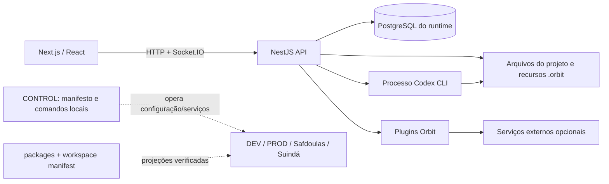

# Mapa arquitetural

## Repositório e runtimes

| Área | Caminho | Evidência/configuração observada |
| --- | --- | --- |
| Orbit DEV | `forge/app` | Web 3001 / API 4001 em `README.md:9-15`; Compose raiz e dados próprios |
| Orbit PROD | `workspace/app` | Web 3000 / API 4000; configuração e banco próprios |
| Safdoulas | `safdoulas/app` | Web 3002 / API 4003; produto e dados próprios |
| Suindá | `suinda/app` | Web 3003 / API 4004; produto, Compose e dados próprios |
| CONTROL | `control/` | Manifesto de ambientes e scripts locais; cobertura não uniforme |
| Fontes compartilhadas | `packages/orbit-core`, `packages/orbit-ui` | Mapeamentos/versionamento declarados em `orbit.workspace.json` e locks |
| Ferramentas de desenvolvimento | `tools/orbit/` | CLI de catálogo, geradores, contexto, verificações, planejamento e entrega |

O README descreve uma branch Git única `main` e runtimes que permanecem em diretórios próprios. O monorepo não implica que todo arquivo tenha sido extraído: as projeções compartilhadas são apenas os arquivos listados em `orbit.workspace.json`; o restante segue em cópias locais. Ver `README.md:1-27`, `MONOREPO.md:5-45` e `docs/acceleration/README.md:29-45`.

## Componentes e comunicação

O diagrama representa os caminhos presentes no código/configuração, não uma medição de rede ou confirmação de disponibilidade externa.

### Interface

O frontend Next.js expõe páginas para Home, quadros, busca, inbox, calendário, extensões, plugins, acessos, workspaces e configurações. A interface consome API via módulos `lib/api.ts`, e áreas colaborativas usam Socket.IO. A lista completa de rotas DEV aparece em `forge/app/apps/web/app/`; Home e quadro são `app/page.tsx` e `app/board/[id]/page.tsx`.

### API e dados

`main.ts` registra a API central, autenticação, regras de domínio e controladores. Serviços especializados ficam em `access/`, `execution/`, `plugins/`, `calendar/`, `git/`, `delivery/`, `workspaces/` e outros módulos. PostgreSQL é acessado pelo serviço `Db` (`forge/app/apps/api/src/db.ts`). `migrations.ts` aplica migrações versionadas; o schema-base e os arquivos numerados vivem em `apps/api/sql/`.

O schema combina tabelas centrais relacionais (usuários, workspaces, quadros, listas, cartões e atividades) com tabelas especializadas por capacidade. Plugins de domínio também podem contribuir tipos de registro para a persistência versionada compartilhada, implementada nas tabelas `extension_records` e `extension_record_versions` (`sql/migrations/118_extension_records.sql`).

### Extensibilidade

`PluginDefinition` registra versão, pai, dependências, escopo, rotas, permissões, capacidades, ações, provedores e contribuições (`forge/app/apps/api/src/plugins/contract.ts:224-248`). `PluginRegistry` valida registro, dependências, bloqueios e ações (`execution/registries.ts`). Contribuições podem adicionar navegação, tipos/layouts de cartão, views, record kinds, eventos, notificações e provedores.

## Tecnologias observáveis

- Web: Next.js, React, TypeScript, Tailwind e componentes locais.
- API: NestJS, TypeScript e Express.
- Persistência: PostgreSQL com SQL e migrations numeradas.
- Eventos em tempo real: Socket.IO.
- Execução local: Node.js `child_process` para Codex CLI e outros processos gerenciados.
- Testes encontrados: Node test/tsx, unitários, integração e browser; não executados nesta sondagem.

## CONTROL e operação

Há um `control/environments.json`, uma CLI Python em `control/bin/orbit-env.py`, arquivos Compose/Dockerfiles e scripts de backup/verificação. O helper examinado enumera DEV e PROD, enquanto a configuração do monorepo lista quatro produtos. A relação entre o container de CONTROL definido no Compose raiz e os arquivos CONTROL existentes requer validação executável, não realizada aqui. Consulte `07-LACUNAS-E-CONTRADICOES.md`.
