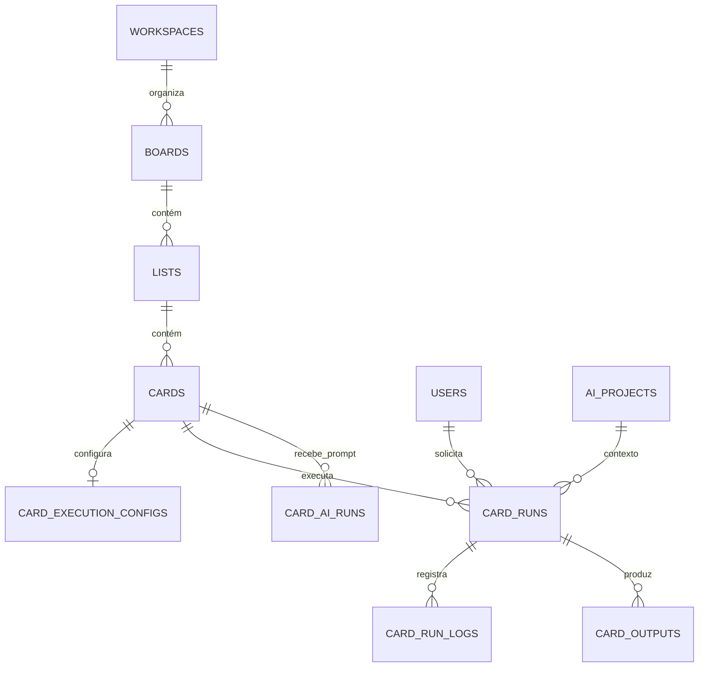

# Persistência e estados

## Modelo relacional central

| Entidade | Relação e finalidade | Evidência |
| --- | --- | --- |
| `users` | contas e preferências | `forge/app/apps/api/sql/schema.sql:2-13` |
| `workspaces` | proprietário e agrupamento | `schema.sql:53-58` |
| `workspace_members`, `workspace_resources` | membros e compartilhamento limitado de recursos | migrations `068_rbac_privileges_groups.sql`, `069_workspace_resource_sharing.sql` |
| `boards` | quadro, opcionalmente relacionado ao workspace | `schema.sql:59-76` |
| `lists` | lista vinculada ao quadro | `schema.sql:89-102` |
| `cards` | cartão vinculado à lista | `schema.sql:103-142` |
| `comments`, `checklists`, `attachments`, labels, assignees, watchers | conteúdo e associações de cartão | `schema.sql:143-258` |
| `activities`, `notifications` | feed de atividade e avisos | `schema.sql:259-286` |
| `card_execution_configs` | configuração de execução por cartão | migration `001_executable_cards.sql:1-16` |
| `card_runs`, `card_run_logs`, `card_outputs` | execução, logs e resultados | migration `001_executable_cards.sql:17-49`; migration 002 |
| `card_ai_runs` | execuções de prompt AI, estados, sessão e resultados | `schema.sql:408-462`; migrations 013, 032/033 e adjacentes |
| `access_roles`, `access_grants`, `access_audit` | RBAC, grants e trilha de acesso | migration `065_rbac_core.sql` |
| `extension_records`, versions, links, operations | records de domínio de plugins, com revisão imutável por registro | migration `118_extension_records.sql:1-70` |
| `immutable_audit_events` | cadeia de eventos auditáveis | migration `119_immutable_audit_history.sql` |
| `orbit_knowledge_embeddings` | vetores de busca semântica escopados | migration `144_orbit_knowledge_embeddings.sql:1-12` |

## Estados observados

`card_runs.status`: queued, running, success, failed, cancelled (`migration 001:25`). Logs capturam estágio e mensagem. Configuração corrente do cartão fica separada do snapshot de entrada do run. Chave única por cartão impede dupla execução da mesma requisição.

`card_ai_runs` tem estados adicionais de espera por resposta, com `codex_session_id`, worker, heartbeat, cancel flag, prompt, output/error, resumo e alterações de arquivo (`schema.sql:408-462`). Os workers detectam execução parada; o significado exato de estados e transições está em `plugins/ai/prompt-sessions.ts`.

Cartões usam estado/arquivamento no registro, mas não há histórico geral de revisões do conteúdo encontrado. `activities` registra eventos e não guarda versão completa restaurável do cartão. O modelo de registros de plugins é diferente: `extension_records.revision` e `extension_record_versions` mantêm versões do domínio.

## Vínculos de execução

Os vínculos são persistidos por foreign keys onde definidos. `card_runs.chain` existe como UUID array, mas não foi localizada orquestração consumidora que estabeleça uma cadeia de dependências entre cartões.

## Migrações e isolamento

DEV, PROD, Safdoulas e Suindá mantêm diretórios `apps/api/sql` e dados/configuração próprios. `migrations.ts` aplica os arquivos numerados em sequência com controle de versão. O mapeamento de runtimes está em `orbit.workspace.json` e `control/environments.json`; não foram consultados bancos para comparar versão aplicada, conteúdo ou consistência entre ambientes.

## Limites de auditoria/recuperação

- Atividades de cartão não são equivalentes à cadeia imutável de auditoria de acesso.
- Runs têm histórico e logs, mas execuções stale são marcadas como falha; replay sem duplicar efeitos externos não foi confirmado.
- O conteúdo atual de um cartão não possui snapshot restaurável localizado.
- Dados do banco não foram lidos nesta sondagem. O modelo foi derivado de DDL e consultas do código.
