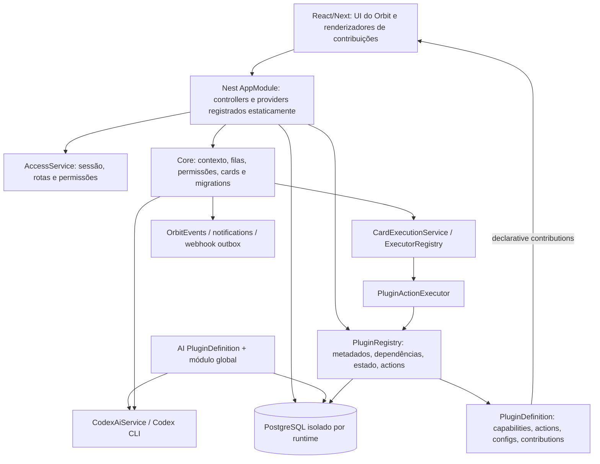
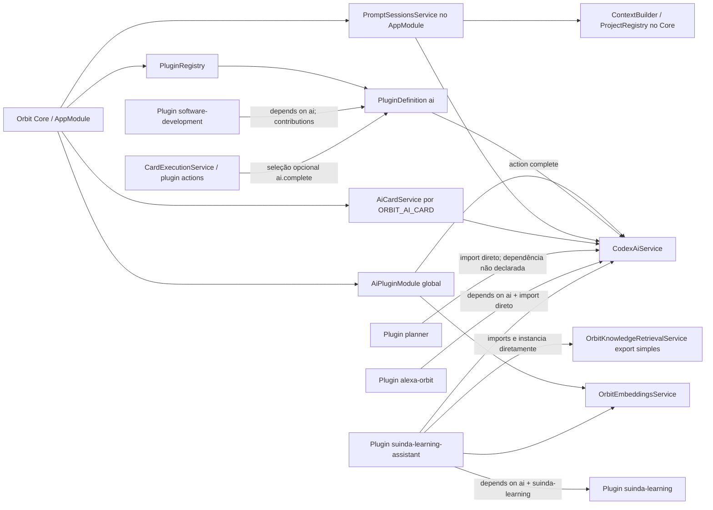

# Auditoria de plugins, IA e desacoplamento

**Data:** 2026-11-13
**Repositório:** `/home/meada/projetos/orbit`
**Escopo:** inspeção arquitetural somente de leitura; sem implementação ou execução de testes.

## 1. Resumo executivo

O Orbit possui um sistema real de plugins: há contratos declarativos, capabilities/actions, validação de schemas, dependências, compatibilidade com o core, contribuições de interface e dados de plugins em registros versionados. O host pode executar actions de plugin com permissões e identidade de projeto/cartão/run. Essa base é útil e deve ser preservada.

A intenção informada — plugin base IA como fornecedor comum e desacoplado — é **parcialmente implementada**:

- O plugin tem o identificador `ai`, metadados no `PluginRegistry`, uma action `ai.complete`, um módulo Nest global com `CodexAiService` e `OrbitEmbeddingsService`, e controla se o provider Codex aceita novas chamadas.
- Entretanto, o módulo Nest não é carregado/descarregado pelo registry. Ele e os controladores/serviços do produto são registrados estaticamente no `AppModule`. O registry gerencia o estado e as contribuições declaradas, mas não isola processos, módulos Nest, rotas ou bancos por plugin.
- `PromptSessionsService`, `ContextBuilder`, `ProjectRegistry`, execução genérica, quotas, roteamento de várias APIs e autorizações estão fora do módulo base IA ou no host. O provider é acessado diretamente por esses componentes.
- `PlannerPlugin` e `AlexaOrbitService` importam `CodexAiService` diretamente; `PlannerPlugin` não declara dependência `ai`. O assistente de aprendizagem do Suindá declara a dependência, mas importa classes internas de IA e instancia diretamente o serviço de recuperação vetorial.
- Há recuperação lexical em código de produto e uso vetorial operacional no assistente do Suindá. O serviço vetorial base, sozinho, não descobre fontes, não autoriza candidatos e não injeta resultados em todos os prompts.
- A arquitetura usa cópias de runtimes e projeções de pacotes compartilhados. Relatório 19 já registrou drift no estado atual; esta auditoria também observou diferenças de hash nos arquivos de IA entre runtimes. Não se fez verificação funcional das combinações.

**Síntese:** o plugin `ai` funciona como fornecedor de algumas capacidades de baixo nível, mas não como fronteira única para o conjunto de funcionalidades inteligentes. Há desacoplamento declarativo no registry e acoplamento de implementação via Nest/TypeScript imports. Ainda é possível evoluir contexto e consistência global sem substituir o registry: contratos estáveis no host podem coordenar contribuições de plugins, enquanto o plugin IA permanece adaptador/provedor para modelos, embeddings e Codex. Essa é uma opção fundamentada, não uma arquitetura escolhida nesta auditoria.

## 2. Identificação do estado analisado

- HEAD: `d9307b8e6a54316f802acbd7bcb96baa26116f16`, branch `main`.
- Arquivos rastreados coincidem com o HEAD. Antes desta auditoria, os relatórios 18 e 19 já apareciam como arquivos não rastreados; foram preservados.
- Inspecionados diretamente: `forge/app` como referência central, fontes `packages/orbit-core` e `packages/orbit-ui`, além dos runtimes `workspace/app`, `safdoulas/app` e `suinda/app` para diferenças relevantes.
- Banco, processos, serviços, containers e configurações secretas não foram consultados. Nenhuma chamada a IA, API paga, migração, build ou teste foi executada.
- Achados a seguir são de inspeção estática, salvo quando citam testes que existem, mas que não foram executados.

**Classificações:**

- `CONFIRMADO PELO CÓDIGO`: caminho e responsabilidade observados na implementação.
- `CONFIRMADO POR TESTE EXISTENTE — NÃO EXECUTADO`: há teste que cobre o comportamento, sem execução nesta auditoria.
- `INFERIDO`: conclusão provável derivada das ligações estáticas, não demonstrada em runtime.
- `NÃO VERIFICADO`: não foi possível concluir pela inspeção feita.
- `DECISÃO ARQUITETURAL PENDENTE`: escolha que precisa do responsável pelo produto/arquitetura.

## 3. Arquitetura geral dos plugins

### 3.1 Contrato e registro

`PluginDefinition` declara `id`, versão, compatibilidade com o core, plugin pai, dependências, rotas, escopo, configuração, capabilities, actions, connection provider, policies de registros, eventos e contribuições de UI/dados (`forge/app/apps/api/src/plugins/contract.ts:224-248`). `definePlugin`, `defineAction` e `defineCapability` validam identificadores e schemas e congelam partes das definições (`plugins/sdk.ts:35-47,78-111`).

O `PluginRegistry` em `forge/app/apps/api/src/execution/registries.ts:13-163`:

- recebe definições por `register(plugin)`; rejeita IDs/versões inválidos, duplicatas, configurações conflitantes, schemas inválidos, contributions inválidas e incompatibilidade com o core (`:21-74,95-108`);
- resolve `dependencies` recursivamente, detecta ciclos e informa dependências ausentes (`:105-128`);
- computa `blockedBy`, `dependents`, `isEnabled`, seleção de plugins para layouts e valida actions/capabilities (`:122-160`);
- publica um catálogo que inclui versão, pai/filhos, dependências, estado, capabilities, actions e contributions (`:162`).

Não há descoberta automática de módulos lendo diretórios. `main.ts` importa serviços, controladores e definições e registra-os explicitamente num factory (`forge/app/apps/api/src/main.ts:30-68,1326-1335`). O array `genericPlugins` também é importado/registrado explicitamente (`main.ts:8-12,1334`). O `PluginRegistry` não instancia ou inicializa classes Nest; ele mantém definições de plugin e despacha actions.

O `register` permite que uma dependência ainda não registrada permaneça temporariamente pendente (`dependencyChain(..., false)`, `registries.ts:107-108`). Depois que o registry está montado, `isEnabled` exige cadeia registrada e ativa (`:117-128`). A ordem explícita do factory é a ordem de registro, não uma ordem automática de inicialização de serviços. `dependencyChain` fornece uma lista topológica para seleção, mas não controla bootstrap Nest.

`dependencies` são IDs sem intervalos de versão. Não há campo de dependência opcional nem range semântico por dependência. `parentPlugin` exige também a dependência do pai (`contract.ts:230-232`; `registries.ts:105-106`). `coreCompatibility` valida faixa/API do core, e não a versão de um plugin dependente (`plugins/core-compatibility.ts:3-8`).

### 3.2 Inicialização, ativação e falhas

O Nest declara os providers e controllers no módulo raiz. Desativar ou desinstalar um plugin muda o estado consultado pelo registry; não remove seu módulo, provider ou controller do processo. O factory carrega `plugin_settings` e `plugin_installations`, aplica essas flags e configura serviços como `CodexAiService` para consultar `registry.isEnabled('ai')` (`main.ts:1326,1334,1360`; migration `142_optional_plugin_installations.sql:1-5`).

O registry distingue desativado (`plugin_settings.enabled`) de não instalado/oculto (`plugin_installations.installed` e `ORBIT_HIDDEN_PLUGINS`); o catálogo omite os não instalados, enquanto `isEnabled` também respeita dependências e visibilidade (`registries.ts:112-136`). Não há hot unload de provider ou encerramento genérico de plugin.

Validação de definição ou injeção de dependência pode lançar durante a criação do registry/bootstrap. Não foi encontrado isolamento de falha por processo ou sandbox de plugin. Erros de `ActionDefinition.execute` são propagados pelo `PluginActionExecutor` e podem falhar o run inteiro (`execution/plugin-action-executor.ts:10-17`; `registries.ts:145-160`). Workers e serviços individuais tratam alguns erros localmente, mas não existe uma fronteira universal que impeça uma falha de módulo Nest de afetar a API.

**Consequência:** `PluginDefinition` é uma fronteira de catálogo, acesso e composição declarativa; não é, por si só, fronteira de carregamento, processo ou falha.

### 3.3 Comunicação e contribuições

Actions recebem contexto com `userId`, `workspaceId`, `projectId`, `cardId`, `runId`, conexão, execução, logger e `services` (`contract.ts:13-28`). Hoje o serviço compartilhado tipado em `services` é principalmente `notifications`; `PluginActionExecutor` passa essa capacidade no contexto (`execution/plugin-action-executor.ts:13-16`). Assim, existe um caminho para consumo por contrato, mas ainda não um catálogo genérico de serviços ou descoberta de capabilities providas dinamicamente por outros plugins.

O host integra actions por `PluginRegistry.execute`: verifica plugin ativo, action, permissions, capabilities requeridas e input schema; chama o autorizer e passa identidade/run (`registries.ts:142-160`). `CardExecutionService` aceita `integrations` de plugin e as executa em sequência no run (`execution/execution.service.ts:114-127`). Actions podem ainda ser escolhidas como executor por `PluginActionExecutor`.

Rotas continuam sendo controllers Nest estaticamente registrados. `handlesRoute`/`routePermission` fornecem metadados ao `AccessService`, que associa rota a permissão; eles não criam uma rota/controller no Nest (`plugins/contract.ts:233-236`; `access/access.ts:50-59`).

Contribuições de navegação, layouts, tipos de card e views são declarações. A interface usa renderizadores do Orbit e slots conhecidos; por exemplo `CardLayoutsService` compõe layouts selecionados a partir do registry (`plugins/card-layouts.ts:9-18`). Isso evita carregar UI arbitrária por plugin, mas uma contribuição nova que exige renderizador ainda depende da UI compartilhada.

Há eventos em três níveis diferentes, que não devem ser confundidos:

1. `OrbitEvents` publica eventos Socket.IO tipados de plugin, board, notificação, progresso de prompt e comentário (`forge/app/apps/api/src/orbit-events.ts:5-22`). É um barramento de atualização para clientes, não um RPC geral entre plugins.
2. `PluginNotifications` oferece publicação de notificações e processamento/outbox (`plugins/notifications.ts:28-66`).
3. `recordEvents` permite a plugins declarar eventos versionados decorrentes de snapshots de registros de outro plugin, com dependência explícita e entrega por webhook (`contract.ts:191-197,243-246`; `plugins/records/records.service.ts:1095-1105`; `plugins/webhooks.ts:13-20`). Esse é um contrato de eventos de domínio limitado, não um bus universal para qualquer capacidade.

### 3.4 Configuração, permissões, persistência e migrations

As definições carregam campos de configuração e suas chaves; o registry valida formato e duplicidade global das chaves (`registries.ts:29-40`). `plugin_settings` armazena `plugin_id`, estado habilitado e timestamp (`sql/schema.sql:42-46`); `plugin_installations` guarda instalação/visibilidade (`sql/migrations/142_optional_plugin_installations.sql:1-5`). Configuração efetiva também pode vir do ambiente e de tabelas próprias do domínio. O plugin IA declara `CODEX_BIN`, timeout e variáveis de embeddings, mas providers leem variáveis de processo; preferências de modelo/esforço ficam ligadas a usuário, board, projeto ou card.

Permissões são registradas no AccessService a partir de actions/capabilities/plugins, e a action é revalidada pelo registry no momento de execução (`access/access.ts:53-59`; `registries.ts:145-160`). Isso dá uma checagem determinística na entrada do action. Imports diretos de providers não passam por essa validação genérica e dependem das autorizações da rota/serviço chamador.

O banco é compartilhado dentro de cada runtime, com tabelas de domínio e nomes/prefixos por capacidade. Não há schema/database dedicado por plugin. Migrations são numeradas por aplicação e aplicadas por um runner central com checksum imutável (`forge/app/apps/api/src/migrations.ts:7-20`). Não existe lifecycle de migrations declarado em `PluginDefinition`, nem rollback/down migration por plugin. Registros extensíveis têm isolamento lógico por workspace/plugin/kind e revisões no mecanismo comum (`plugins/records/records.service.ts`; contrato `RecordKindContribution` em `plugins/contract.ts:86-176`).

Desativação/remoção lógica não apaga automaticamente tabelas, embeddings, registros ou histórico. A migration de instalação não define limpeza de dados. Os dados continuam no DB, enquanto os caminhos que consultam `isEnabled` podem bloquear operações.

### 3.5 Diagrama da estrutura observada

**Evidência:** `CONFIRMADO PELO CÓDIGO` para wiring estático, registro, execution registry, DB e eventos nos caminhos citados. O diagrama não significa isolamento de processo ou disponibilidade operacional verificada.

## 4. Inventário dos plugins relacionados à IA

| ID/camada | Objetivo e relação com IA | Dependência declarada | Consumo/contrato | Persistência e indisponibilidade |
|---|---|---|---|---|
| `ai` | Plugin base: catálogo/configuração, layout do assistente e action `complete`. | Nenhuma dependência declarada. | Registra `CodexAiService` como action `complete`, capability `ai.assistance`, permission `ai.write`; exporta metadados e módulo Nest global. | Usa `plugin_settings`, projetos, runs, embeddings e dados relacionados; serviço de Codex é bloqueado por `isEnabled('ai')`. |
| `software-development` | Tipos/layouts de card para demanda de software, slots de desenvolvimento e classificação executável/contexto. | `ai` obrigatória (`plugins/software-development/software-development.plugin.ts:2`). | Contribui metadados de card/layout; não importa `CodexAiService` diretamente. A dependência preserva os slots AI associados ao tipo. | Sem persistência de IA própria; layout de card é salvo pelo host. Desativar IA bloqueia o layout/cadeia pelo registry. |
| `planner` | Ações de planejamento e sugestão de agenda. É plugin de domínio que chama IA. | **Não declara `ai`** em `plannerPluginDefinition` (`planner/planner.plugin.ts:209-225`). | Importa/injeta diretamente `CodexAiService` (`:5,29-36`) e chama `aiSchedule`; também expõe actions `suggest_schedule`. | Usa tabelas `planner_rules`, `focus_events`, `planner_suggestions` etc. O provider recusa chamadas quando AI está desativado; o metadata do Planner não reflete essa dependência. |
| `alexa-orbit` | Integração de voz que pode encaminhar pedidos a trabalho de IA em background. | `ai` declarada; plugin inicia desativado por padrão no registro (`alexa-orbit.plugin.ts:11`; `main.ts:1334`). | Importa `CodexAiService`; injeta-o opcionalmente e verifica `plugins.isEnabled('ai')`/presença do provider (`alexa-orbit.service.ts:4,21,64-75,81`). | Jobs e requests Alexa persistidos em tabelas próprias; sem AI, rotinas de IA respondem indisponível, e dependência declarada bloqueia o plugin. |
| `suinda-learning-assistant` (Suindá) | Dúvidas acadêmicas, recomendações e material docente; é o consumidor operacional de RAG encontrado. | `suinda-learning` e `ai` obrigatórias; `parentPlugin: suinda-learning` (`suinda/app/apps/api/src/plugins/suinda/learning-assistant.ts:329-340`). | Importa diretamente `CodexAiService`, `PromptSessionsService`, `OrbitEmbeddingsService` e `OrbitKnowledgeRetrievalService` (`:3,8-10`); usa lexical retrieval com fallback e busca vetorial por curso (`:189-230`). | Contexto vem de aulas publicadas/liberadas após validação de matrícula; escopo inclui workspace, `suinda-learning` e collection de curso (`:193-219`). Sem AI retorna erro 409; sem embedding mantém busca lexical. |
| `ai.complete` como integração de card | Permite selecionar action do plugin IA na configuração de um run. | Dynamic integration, não uma dependência estática de plugin. | `PluginRegistry.validate/execute` verifica action, capability, permission e schema. | Persistência do run genérico registra input/outputs; indisponibilidade causa erro de execução. |
| Serviços de card/contexto e execução | Funcionalidades inteligentes expostas em APIs/cartões. Não correspondem a plugin separado em todos os caminhos. | Acoplamento host → serviços IA. | `AiCardService` implementa `ORBIT_AI_CARD`; `PromptSessionsService` injeta provider; `CardExecutionService` usa `CodexExecutor` e `PluginRegistry`. | `card_ai_runs`, `card_runs`, projetos e logs. Desativar IA bloqueia Codex mas não descarrega controllers/providers. |

O conjunto de plugins que **declara** dependência direta de `ai` é menor do que o conjunto de serviços que realmente importa o provider. Além dos IDs da tabela, `PlannerPlugin` é um consumidor direto sem dependência declarada. Consumo futuro de `ai.complete` pode ser escolhido em configuration de um card e não aparece como dependência fixa de código.

**Classificação:** `CONFIRMADO PELO CÓDIGO` para referências, metadados e comportamentos de gating; funcionamento efetivo de serviços externos/modelo `NÃO VERIFICADO` nesta auditoria.

## 5. Anatomia do plugin base IA

### 5.1 Registro e serviços

- ID: `ai`; definição e versão `1.0.0` em `forge/app/apps/api/src/plugins/ai/ai.plugin.ts:7-18`.
- O factory do `PluginRegistry` registra `aiPluginDefinition(ai)` e registra os outros plugins explicitamente (`main.ts:1334`). `ai.setAvailability(() => registry.isEnabled('ai'))` liga o provider ao estado do registry (`main.ts:1360`).
- `AiPluginModule` é `@Global()` e exporta `CodexAiService` e `OrbitEmbeddingsService` (`ai.plugin.ts:1-11`). Isso facilita injeção por toda a aplicação, mas cria acoplamento global em runtime.
- `OrbitKnowledgeRetrievalService` é exportado como classe simples, porém **não** está no array de providers/exports Nest do módulo (`ai.plugin.ts:9-15`). O host consumidor precisa receber DB/embeddings e construir a instância; o assistente do Suindá faz isso diretamente.
- `aiPluginDefinition` registra uma action `complete`, não a execução de prompts em cartão inteira (`ai.plugin.ts:17-18`).

### 5.2 Responsabilidades e localização

| Responsabilidade | Classificação | Evidência e limite |
|---|---|---|
| Acesso ao provider Codex CLI para texto/execução | `IMPLEMENTADA NO PLUGIN BASE` | `CodexAiService.complete/execute` e spawn em `plugins/ai/codex-provider.ts:40-69,95-130`. É uma abstração do processo local, não um SDK de modelo universal. |
| Embeddings vetoriais OpenAI | `IMPLEMENTADA NO PLUGIN BASE` | `OrbitEmbeddingsService.embed` chama endpoint externo e modelo fixo `text-embedding-3-small` (`plugins/ai/embeddings.ts:3-37`). |
| Ranking vetorial | `IMPLEMENTADA NO PLUGIN BASE` | Serviço `OrbitKnowledgeRetrievalService`, candidatos passados pelo host, escopo por workspace/plugin/collection (`knowledge-retrieval.ts:24-35,47-93`). Não autoriza nem descobre conteúdo. |
| RAG aplicado ao domínio | `IMPLEMENTADA EM PLUGIN DEPENDENTE` | Suindá seleciona aulas autorizadas, lexicalmente ranqueia, usa ranking vetorial opcional e injeta fontes/citações no prompt (`suinda/.../learning-assistant.ts:189-230`). Não é RAG automático global do Orbit. |
| Sessões/prompt runs | `COMPARTILHADA ENTRE COMPONENTES` | `PromptSessionsService` está em `plugins/ai/prompt-sessions.ts`, mas é provider do `AppModule`, injeta serviço Codex, lê card/config/contexto, possui worker/locks e atualiza tabelas/eventos (`main.ts:1326`; `prompt-sessions.ts:56-60,413-485,490-568`). |
| Assistência a cards e sugestões | `COMPARTILHADA ENTRE COMPONENTES` | `AiCardService` usa Codex e prompt settings; `ORBIT_AI_CARD` é uma porta tipada consumida pelo serviço de domínio (`plugins/ai/card-service.ts:13-16,47-82`; `plugins/ai-port.ts:1-8`; `main.ts:133,53`). |
| Construção de contexto do executor genérico | `IMPLEMENTADA NO NÚCLEO` | `ContextBuilder` combina card, regras, skills, arquivos, cartões ligados e permissões (`execution/context-builder.ts:11-51`). Prompt sessions têm outra composição própria, não o mesmo pipeline compartilhado integralmente. |
| Registros de projeto, agentes, skills e knowledge `.orbit` | `IMPLEMENTADA NO NÚCLEO` | `ProjectRegistry` lê `orbit.yaml` e recursos do projeto, calcula hash e verifica permissões (`execution/project-registry.ts:26-79`). Não é uma memória global de agentes/plugins. |
| Quotas e pausa de filas Codex | `IMPLEMENTADA FORA DO SISTEMA DE PLUGINS` | `codex-limits.ts` consulta `codex app-server`; filas persistem pause/auto-resume em `users.preferences` (`codex-limits.ts:10-36,55-74`; `plugins/ai/queue-management.ts:7-16`). |
| Execução de actions de plugin | `IMPLEMENTADA NO NÚCLEO` | `PluginRegistry`, `PluginActionExecutor`, schema/capabilities/permissions (`execution/registries.ts:142-160`; `execution/plugin-action-executor.ts:5-18`). A IA fornece uma action, mas não governa todos os plugins. |
| Agentes e colaboração entre agentes | `IMPLEMENTADA FORA DO SISTEMA DE PLUGINS` | Prompt sessions podem passar flag nativa de múltiplos agentes ao Codex (`prompt-sessions.ts:413-416`; `codex-provider.ts:120-127`). O Orbit não registra entidades, mensagens, resultados/custos individuais de agentes no `PluginDefinition`. |
| Memória/sessões | `COMPARTILHADA ENTRE COMPONENTES` | `card_ai_runs` guarda prompt, sessão, estado e resultados (`sql/schema.sql:426-462`); comentários e recursos `.orbit` também compõem contexto. Não há serviço universal de memória entre plugins. |
| Registro de resultados/progresso | `COMPARTILHADA ENTRE COMPONENTES` | `PromptSessionsService` salva estados/outputs e publica progresso por `OrbitEvents`; fila genérica mantém `card_runs` e logs (`prompt-sessions.ts:519-568`; `orbit-events.ts:17-22`; `run-repository.ts`). |
| Permissões e identidade | `IMPLEMENTADA NO NÚCLEO` | AccessService/registry controlam actions e projetos; provider só recebe instruções/caminho e não é autoridade de permissões (`access/access.ts:53-59`; `registries.ts:145-160`). |
| Orquestração de tarefas | `COMPARTILHADA ENTRE COMPONENTES` | `CardExecutionService`/`RunRepository` e `PromptSessionsService` têm filas separadas; plugin IA não coordena sozinho todas as filas. |
| Eventos de plugin | `COMPARTILHADA ENTRE COMPONENTES` | `OrbitEvents`, notifications e record webhook outbox são do host; IA usa e publica progresso, mas não fornece um event bus genérico. |

**Conclusão da anatomia:** o plugin é fornecedor efetivo de Codex, embeddings e action `complete`; sua fronteira não inclui todas as rotas, sessões, filas, contexto, permissões ou observabilidade que realizam funcionalidades de IA.

## 6. Grafo de dependências

### 6.1 Relações de IA

### 6.2 Declaração versus código

- A declaração no registry é usada para calcular bloqueios/habilitação, layout e catálogo. Ela não gera import, módulo ou injeção Nest automaticamente.
- Dependência de compilação aparece em imports concretos como `PlannerPlugin -> CodexAiService` (`planner.plugin.ts:5,34`) e `LearningAssistantService -> classes internas de IA` (`suinda/.../learning-assistant.ts:3,8-10,180-186`).
- Dependência de runtime pelo registry é `PluginDefinition.dependencies`; `alexa-orbit`, `software-development` e `suinda-learning-assistant` declaram `ai`. `PlannerPlugin` não declara apesar de injetar o provider.
- Dependência dinâmica é a action `ai.complete` escolhida em `ExecutionConfig.integrations`; o host valida a cada execução (`execution.service.ts:63-80`; `registries.ts:145-160`).
- Dependência de provider/container é Nest DI: `AiPluginModule` exporta serviços globalmente, e o `AppModule` registra muitos consumidores/provedores juntos. Isso não é mediado por `PluginRegistry`.
- RAG vetorial é dependência de runtime opcional em Suindá: a flag/chave ativa embeddings; se falhar, a busca lexical segue como fallback (`learning-assistant.ts:204-221`).

Não foram encontradas dependências circulares explícitas `ai -> plugin especializado` no grafo examinado. O risco de ciclo é possível por imports/DI futuros, porque não há uma verificação de grafo Nest/TypeScript entre módulos e o registry não vê imports internos. `PluginRegistry` detecta apenas ciclos declarados em `dependencies` (`registries.ts:117-120`).

## 7. Avaliação de desacoplamento

1. **Usar IA sem conhecer implementação interna?** Parcialmente. `ai.complete` é uma action pública com schema/capability; porém Planner, Alexa e Suindá importam serviços concretos. O provider é global Nest.
2. **Atualizar IA sem modificar todos os consumidores?** Não há garantia geral. Mudanças compatíveis na implementação `CodexAiService` preservam a assinatura, mas mudanças no provider/contexto/PromptSessions podem exigir mudanças nos consumidores diretos; nenhuma versão é declarada no contrato da classe.
3. **Consumidores usam contrato público?** Alguns usam `PluginDefinition.actions`; consumidores do Codex e RAG usam imports de arquivos internos (`codex-provider.ts`, `embeddings.ts`, `knowledge-retrieval.ts`, `prompt-sessions.ts`). `ORBIT_AI_CARD` demonstra uma porta interna de domínio mais desacoplada.
4. **Plugins podem oferecer ferramentas?** Sim, por actions/capabilities estáticas e `PluginActionContext`. Não existe descoberta automática de ferramentas do plugin por Codex; o projeto/card precisa configurar integration ou o código chamador importar o serviço.
5. **Descoberta dinâmica de capabilities?** O catálogo lista capacidades registradas e o executor as valida. Descoberta dinâmica externa de módulos ou tools pelo agente não foi localizada.
6. **Dependências verificadas em runtime?** Sim, para IDs declarados: missing/cycle/disabled bloqueiam `isEnabled` e selection. Não valida imports internos, faixa de versão de dependências ou versão de serviço.
7. **Falha isolada?** Não em geral. Actions podem falhar um run; erro no provider NEST, factory ou dependência required pode afetar bootstrap ou rotas que o injetam.
8. **Dependências circulares?** Ciclos declarados são detectados; ciclos entre imports Nest não têm teste/validação equivalente identificada.
9. **Serviços duplicados?** Há dois pipelines de execução (`card_runs` e `card_ai_runs`) e composições de contexto distintas. Isso não prova duplicação indevida, mas responsabilidades semelhantes estão em camadas diferentes.
10. **Execução de card depende de plugin?** O pipeline genérico é do core e oferece `CodexExecutor` e `PluginActionExecutor`. Prompt sessions têm pipeline próprio do IA. Layouts podem bloquear/permitir ações conforme plugin ativo.
11. **Caminhos contornam registry?** Sim: chamadas diretas do Codex por Planner, Alexa, `AiCardService` e assistente Suindá. Continuam protegidas por regras de serviço/rota que variam por caso, mas não passam pela validação genérica de action do registry.
12. **Acoplamento UI/API/provider?** Sim, por endpoints/card slots conhecidos, `aiPlugin` contributions, controladores estáticos e imports diretos da UI. A API também tem callbacks e estado de prompt próprios.
13. **Plugin evolui dados sem quebrar consumidores?** Há schema JSON e registros versionados, mas não há migrations/hook por plugin, range de contrato de dependency nem compatibilidade de output garantida para todo consumidor.
14. **Compatibilidade explícita?** Existe faixa do core e API do plugin (`coreCompatibility`) e lock/hash de fontes compartilhadas; não existe matriz de versão para capabilities/dependencies. Relatório 19 registrou drift atual nas projeções compartilhadas, e os hashes dos módulos de IA variam entre runtimes.

### Limites confirmados e testes existentes

Existem testes para contrato, SDK, registry/execution, compatibilidade de core, embeddings/retrieval, e assistente do Suindá (`plugins/contract.spec.ts`, `sdk.spec.ts`, `execution.spec.ts`, `core-compatibility.spec.ts`, `plugins/ai/knowledge-retrieval.spec.ts`, `suinda/.../learning-assistant.spec.ts`). Esses arquivos demonstram intenção de cobertura, mas **não foram executados** nesta auditoria e não demonstram compatibilidade de todas as combinações de versões/runtime.

**Classificação:** `CONFIRMADO PELO CÓDIGO` para as fronteiras e acoplamentos listados; `CONFIRMADO POR TESTE EXISTENTE — NÃO EXECUTADO` para a presença/objetivo dos specs; compatibilidade operacional completa `NÃO VERIFICADO`.

## 8. Consistência entre plugins e cards

| Cenário | Comportamento e evidência | Limitações/riscos | O que pode ser reaproveitado e o que falta |
|---|---|---|---|
| **E1 — Card depende de vários plugins** | `ExecutionConfig.integrations` identifica plugin/action; no run, host valida estado, permissões, schema e capability, passa `runId/cardId/projectId/userId` e executa as actions em sequência (`execution.service.ts:63-80,114-127`; `registries.ts:145-160`). Layouts calculam dependências. | O run guarda IDs/configuração, não snapshots de versão/core/capability usados. Não há contrato agregado do card que registre todas as versões. | Reaproveitar IntegrationConfig, registry, schema e resolved context. Acrescentar registro versionado de contrato/versões e fingerprint do plano do run. |
| **E2 — Plugin muda/desativa durante execução** | A action é validada antes de chamar `execute`; `setEnabled` afeta chamadas futuras e dependentes. Provider Codex consulta `isEnabled('ai')`. | Definição/versão não é congelada no run. Não há cancelamento coordenado de todas as execuções quando plugin muda; um action já em curso não é interrompido pelo registry. | Reaproveitar `PluginRegistry.isEnabled`, queue status e semver do plugin. Falta pin de versão e política de invalidar/reexecutar/reconciliar. |
| **E3 — Dois plugins alteram o mesmo projeto** | Actions de um run genérico são sequenciais; prompts e generic runs têm workers/filas separados. O Prompt AI mantém lock de cartão/projeto; generic queue tem outro mecanismo. Relatório 18 confirmou a captura/rollback por snapshot pode restaurar alterações de outro escritor. | Sem coordenador comum nem workspace isolado por action/plugin. Execuções distintas podem compartilhar checkout. Não há transação sobre efeitos externos ou rollback distribuído. | Reaproveitar `RunRepository`, locks AI, `captureFileScope`, checks e IntegrationConfig, mas tratar escopo como verificação, não isolamento. Falta decisão por worktree/exclusão e gate comum. |
| **E4 — Usuário atualiza card implementado por vários plugins** | Contexto carrega card, linked cards, skills/rules/files selecionados; Git guarda commits ligados ao card; resultados AI e atividade ficam em histórico. | Não há versão imutável do card que vincule implementação/contratos/plugins ao estado atual. A interface pode mostrar último resultado sem freshness (relatório 18). Não há catálogo inverso “responsabilidade entregue por esses plugins/arquivos/commits”. | Reaproveitar revisions de extension records, atividade, `git_card_commits`, fingerprints de `.orbit` e execution resources. Falta Card Version Manager e vínculo de evidências. |
| **E5 — Plugin publica conhecimento a outros** | `recordEvents` e webhook outbox permitem eventos versionados de registros; serviço RAG recebe scope plugin/collection e candidatos explicitamente fornecidos. Suindá disponibiliza aulas autorizadas ao seu assistente. | Não há registro genérico de descobertas/decisões aprovado e recuperável por outros plugins; ranking vetorial não autoriza candidatos nem associa resultado a revisão/commit. Eventos webhook são distribuição, não memória semântica. | Reaproveitar `.orbit/knowledge`, records versionados, record events, hashes e serviço RAG com autorização do host. Definir proveniência, aceite, escopo, expiração, invalidation e contraditórios. |
| **E6 — Plugin desabilitado/removido** | Registry bloqueia dependentes e paths que chamam `isEnabled`. Instalação e enablement são flags separadas; registros de plugin preservam dono/versões e tabela de migration global. | Providers/controllers/tabelas não são descarregados/removidos. Não há purge/migration/compatibility snapshot associado à desinstalação. Registros podem permanecer, mas UI/ações do owner podem ficar indisponíveis. | Reaproveitar `plugin_installations`, record ownership, policies `enforceWhenDisabled` e migrations imutáveis. Falta política de read-only/export/migrate/purge e roteamento para consumidores após retirada. |
| **E7 — Plugin altera contrato** | SDK valida semver do plugin, schemas e faixa core; action pode declarar output schema; record events têm versão; shared inspector compara hashes entre fonte/projeções. | Não há versão das capabilities/action independentemente do plugin, range de versão em dependencies, consumer graph de imports, ou testes de contrato automáticos para todas as combinações. Drift atual já é sinal no relatório 19. | Reaproveitar schema e compatibility verifier; acrescentar snapshots de dependências do run e testes focados nos consumidores. Especificar política de depreciação/rollback de dados. |
| **E8 — Card executa em filas distintas** | `card_runs` e `card_ai_runs` mantêm estados/locks próprios; UI e APIs compartilham cards e alguns serviços core. | Não existe autoridade global que serialize/compare estado observado entre filas, plugins e fontes. O registry é catálogo de capacidades, não reconciliador de execuções. | Reaproveitar banco, RunRepository, registros, eventos e project checks. Coordenador/Consistency Engine pertence conceitualmente à camada host/core, com validações fornecidas por plugins; sem decisão final nesta auditoria. |

## 9. Fronteiras de responsabilidade

Não é necessário transformar cada capacidade em plugin. As alternativas abaixo mostram fronteiras possíveis e tradeoffs, sem selecionar uma implementação definitiva.

| Capacidade futura | Componente próximo hoje | Alternativas de localização | Vantagens e limites |
|---|---|---|---|
| Project Context Registry | `ProjectRegistry`, arquivos `.orbit`, `workspaces`, record registry | Serviço core que mantém identidade, versão e autorização; plugins declaram fontes/contribuições. Ou registry de domínio em plugin AI. | Core torna o contexto disponível sem IA; exige API estável. Plugin AI pode otimizar a experiência de agente, mas não deve ser a autoridade de acesso/validade. |
| Context Compiler | `ContextBuilder` e builders próprios de prompt sessions | Core/shared package compilando fontes autorizadas; plugins oferecem contribuidores/formatters. Alternativa: orquestrador AI chama builders. | Um compilador comum reduz diferenças entre filas; requer contratos de contexto e limites. Uma composição apenas no AI deixa outros executores sem contexto versionado. |
| Versioned RAG | `.orbit/knowledge`, `OrbitKnowledgeRetrievalService`, busca lexical do Suindá | API local no core para resolver candidatos/autorização; ranking lexical no core e provider vetorial AI opcional; ou retrieval encapsulado em AI com autorização delegada ao host. | Lexical pode operar sem API paga; vetorial depende de provider. Serviço AI atual requer candidatos já autorizados e não é consumidor universal. |
| Context Bridge | spawn/JSONL do `CodexAiService`, `PluginActionContext` | Bridge/identidade/autorização no host; adapter MCP no plugin AI. Ou MCP inteiramente no AI, com contratos do core fornecendo contexto e permissões. | Host consegue negar acesso independentemente do modelo; adapter mantém provider modular. Se tudo estiver no AI, tools não-Codex e serviços sem IA podem ficar acoplados. |
| Project Consistency Engine | `RunRepository`, `PluginRegistry`, project checks, records e shared inspector | Serviço determinístico core; plugins contribuem invariantes/checks e fontes. Alternativa: plugin de desenvolvimento chama os checks do host. | Core coordena todas as filas mesmo sem IA; plugin especializado preserva regra de domínio. Modelo pode sugerir, mas não ser a única autoridade. |
| Desired State Reconciler | APIs de cards/projetos, estados de runs e `ExtensionRecords` | Core compara desejo/observado e agenda trabalho; plugins declaram projeções e reconciliações. | Visão global e idempotência no host; maior disciplina de contratos e retenção. Se encapsulado só no AI, reconciliador para sem IA. |
| Card Version Manager | tabela `cards.updated_at`, card activity, record revisions | Core mantém revisão imutável e estado do card; plugins associam artefatos/contratos/commits. | Revisão continua disponível com IA desligada e vale para todo tipo de card; migração/retention é necessária. |
| Integration Gate | `runProjectChecks`, `captureFileScope`, plugin/core compatibility | Gate core determinístico que agrega checks declarados; plugins fazem validators especializados. | Centraliza critério de aceite; checks podem variar por produto. Relatório 18 confirma que captura/rollback atual não isola concorrência. |
| Codex Session Manager | `card_ai_runs.codex_session_id`, provider e prompt worker | Sessão/provider no plugin AI; core fornece revisions, identity, path e política de validade. | Mantém Codex específico modular, sem deixar o plugin decidir freshness de card/projeto sozinho. |

### Condições para evitar dependência circular

- Se o host/core precisa saber identidade, permissões, revisão ou consistência, definir esses contratos no core/shared contract, sem importar classes do plugin AI.
- O plugin AI pode implementar interfaces/tokens do host e usar serviços autorizados que o host lhe entrega; plugins especializados declaram contributions e dependências, em vez de importar `codex-provider.ts` ou `knowledge-retrieval.ts`.
- APIs de interface devem expor DTOs/schema versionados, não classes Nest internas.
- `PluginRegistry` pode continuar orquestrando definição/permissions; não deve se tornar executor de toda lógica de negócio.
- Quando AI estiver desligado, cards, records, permissions, version registry, event history e gate determinístico devem permanecer ativos. Geração, embeddings e ferramentas Codex podem ficar indisponíveis.

## 10. Comunicação bidirecional

### Mecanismos existentes

- Orbit envia prompt ao Codex via stdin e recebe mensagem/JSONL, `thread_id`, file changes e atividades por callbacks (`plugins/ai/codex-provider.ts:95-130,172-216`).
- `PromptSessionsService` salva sessão, estados e outputs, publica `prompt:progress`, e suporta resposta a perguntas (`plugins/ai/prompt-sessions.ts:519-568`; `orbit-events.ts:17-22`).
- O genérico executa integrations/actions usando contexto tipado (`execution/types.ts:11-13`; `plugins/contract.ts:13-41`).
- O catálogo de plugins expõe capabilities e actions já registradas (`execution/registries.ts:142-162`).
- Record webhooks transportam eventos de domínio versionados e filtrados por subscription (`plugins/webhooks.ts:13-55`; `records.service.ts:1095-1105`).

### Lacunas para o Context Bridge

- O provider de prompt é um subprocesso, não recebe atualmente um serviço MCP Orbit configurado como tool. O executor genérico desabilita configuração do usuário e define `mcp_servers={}` (`execution/codex-executor.ts:22-27`); provider de prompt não monta flag de MCP customizado (`codex-provider.ts:118-128`).
- `CodexAiService.execute` recebe prompt/caminho/modelo/esforço e callbacks, mas não um contrato completo de autorização com project/card/run; PromptSessions conhece esses IDs no host, mas não os passa como contexto de ferramenta (`prompt-sessions.ts:529-532`).
- Não há RPC durante a execução para perguntar por decisões, regras, versões ou recuperar fontes novas. O que vai ao Codex é contexto pré-compilado em prompt, mais eventos/progresso de retorno.
- Eventos de saída do modelo são dados não confiáveis; operações propostas por agente exigiriam chamada estruturada, validação de schema, autorização do host em cada operação, idempotência/audit e relação com revision do card.
- Nenhuma API geral publica agentes de plugins para comunicação direta plugin-a-plugin. Hoje cooperação ocorre por actions, DB/domain services, registros e webhooks específicos.

Uma interface de capacidades do plugin AI pode ser ampliada sem expor classes: plugin especializado declara ou registra capability/tool por contrato, o host resolve autorização e encaminha o invocation ao provider. Alternativamente, o core pode expor APIs de contexto/read-only para qualquer executor e o AI usar apenas seu adapter MCP. O limite de segurança e identidade precisa permanecer no host, independentemente do modelo.

## 11. RAG, memória e conhecimento compartilhado

### Fontes e recuperação existentes

1. **Conhecimento de projeto:** `ProjectRegistry` lê `.orbit/agents`, `skills`, `rules`, `knowledge`, plugins e `orbit.yaml`, calcula hash de documentos e valida referências/permissões (`forge/app/apps/api/src/execution/project-registry.ts:26-79`). `ContextBuilder` inclui recursos selecionados no prompt (`execution/context-builder.ts:26-51`). É contexto explícito, não índice global automático.
2. **RAG vetorial da IA:** `OrbitKnowledgeRetrievalService.rank(scope, query, candidates)` recebe até 200 candidatos do host, busca/reusa embeddings por hash, elimina embeddings fora do conjunto quando invocado e devolve ranking (`plugins/ai/knowledge-retrieval.ts:24-93`). Serviço não autoriza conteúdo e não é provider do Nest.
3. **Embeddings:** modelo fixo `text-embedding-3-small`, 1536 dimensões; só habilitado com flag e chave e chama API OpenAI (`plugins/ai/embeddings.ts:3-37`; migration `144_orbit_knowledge_embeddings.sql:1-12`). Mesmo com vetor de documento em cache, query nova precisa ser embedada externamente.
4. **Busca lexical local no Suindá:** `retrieveLearningSources` ranqueia títulos, objetivos e conteúdo; o assistente primeiro verifica a projeção de matrícula/acesso e monta apenas aulas publicadas/liberadas (`suinda/app/apps/api/src/plugins/suinda/learning-assistant.ts:129-164,189-205`). É fallback sem custo de embeddings/API.
5. **RAG vetorial no Suindá:** se embeddings estão configurados, consulta workspace autorizado e chama ranking com plugin `suinda-learning` e collection do curso; se ranking falha, mantém seleção lexical (`learning-assistant.ts:206-221`). O prompt recebe fontes citáveis e trata conteúdo como dado não confiável (`:166-175,223-232`). Esse é o consumidor operacional concreto localizado nos runtimes.
6. **Memória de sessão:** card AI persiste `codex_session_id`, prompt/output e status em `card_ai_runs` (`schema.sql:426-462`). A retomada é por cartão/projeto em PromptSessions; isso não é memória compartilhada global entre plugins.

### Limites de autorização, versionamento e invalidação

- Scope vetorial contém workspace, plugin e coleção, mas é o host que deve selecionar candidatos autorizados. No Suindá a autorização de matrícula/aula precede busca; essa regra é específica daquele produto.
- `content_hash` identifica texto de embedding, mas não inclui, por si só, versão de card, commit, autor/aprovação, licença, validade ou versão de contrato do plugin.
- Ranking remove vetores ausentes da coleção corrente quando `rank` é invocado; não existe evento universal de invalidação acionado por `PluginRegistry` para todo o conhecimento. Retention service tem política própria.
- Contradições e precedência entre fontes não são resolvidas por registry. O assistente do Suindá restringe resposta a material recuperado e retorna citações, mas isso não constitui política de conhecimento compartilhado entre produtos.
- Serviços sem API paga reaproveitáveis: leitura dos arquivos `.orbit`, hashes locais, busca lexical BM25 da ferramenta `tools/orbit/knowledge.mjs` e o ranking lexical local do Suindá. Vector embeddings de consulta requerem API externa no código atual.

**Risco:** disponibilizar um RAG global somente no AI plugin pode misturar fontes ou contornar permissão se aceitar que plugin forneça texto sem identidade/proveniência. A autorização, origem e validade precisam ser verificáveis pelo host; retrieval é ranking, não controle de acesso.

## 12. Evolução e compatibilidade

### Mecanismos existentes

- Versão semântica do plugin e compatibilidade `coreCompatibility` com faixa e `pluginApiVersion` (`contract.ts:224-232`; `plugins/core-compatibility.ts:3-8`). Registry e SDK aplicam validação no registro.
- Schemas de entrada/saída para actions e schema de registro (`sdk.ts:41-46`; `registries.ts:41-74,145-160`).
- Records de plugins com `plugin_id`, kind, schema, state e revision, histórico de versões e policies (`contract.ts:86-176`; `plugins/records/records.service.ts`).
- Migrations com checksum e recusa de alteração retroativa (`migrations.ts:7-20`).
- Manifesto de pacotes compartilhados, hashes e locks de projeções, além de verificador entre runtimes. Relatório 19 constatou divergência de fonte/projeção/versão no HEAD, portanto o mecanismo não significa que os ambientes estejam efetivamente sincronizados.
- Testes de unidade/integration por registry, records, execução e IA existem, mas não foram executados nesta investigação; não cobrem automaticamente todas as combinações de plugins/runtimes.

### Limites

- `PluginDefinition.version` é validada como semver, mas consumers não declaram constraints como `ai >= 1.2 < 2`. Dependencies declaram apenas IDs.
- `CapabilityDefinition` e `ActionDefinition` não têm versão individual. Alterar output/schema pode afetar projeto/card e integrações que salvam só `plugin`, `action`, config.
- O registro do run não fixa versão/integrity do plugin, core, action schema ou contexto que executou.
- Atualização/rollback de plugin não tem lifecycle de migration ou hooks de compatibilidade definidos pelo plugin. Migrations globais são aplicadas no boot e sem down automático.
- Plugin desativado continua com providers/controladores carregados; plugin removido não tem data cleanup automático, política de export ou tombstone no catálogo demonstrada.
- Cópias/runtime mostram diferenças de AI modules: hashes de `ai.plugin.ts`, `codex-provider.ts` e `prompt-sessions.ts` não são idênticos entre os quatro ambientes; o registry/contract/context/run-repository são idênticos nos hashes checados. Diferença não significa automaticamente bug, mas requer que cada diferença seja declarada intencional, reconciliada/projetada, ou validada por compatibilidade.
- Caso concreto: Suindá não reexporta `OrbitKnowledgeRetrievalService` de `ai.plugin.ts`, enquanto DEV/PROD/Safdoulas reexportam; o assistente Suindá importa o caminho interno `../ai/knowledge-retrieval.ts` diretamente. Isso é evidência de API de plugin não estabilizada para essa capacidade, não evidência de falha funcional.

## 13. Matriz de reaproveitamento

| Componente | Responsabilidade/capacidade | Consumidores | Reuso potencial | Risco de alteração |
|---|---|---|---|---|
| `PluginRegistry` | Estado/dependências/actions/capabilities/catalog | API, layouts, records, executor | Base de discovery/authorization/dispatch; adicionar metadados de contribuição de contexto sem alterar carregamento atual. | Imports internos não aparecem no grafo; erro/semver não abrange módulo Nest ou dependências por faixa. |
| `PluginDefinition` + SDK | Contratos e contribuições validadas | Plugins do core e produto | Evoluir para capabilities tipadas/versões e compatibilidade; mantém schema validation. | Mudanças ao contrato afetam todos os runtimes/cópias. |
| `PluginActionContext` | Identidade/contexto de invocation | Actions de plugin | Pode transportar contexto de Context Bridge com scope mínimo e services tipados. | Atualmente `services` é pequeno; adicionar objetos amplos pode criar service locator e acoplamento. |
| `AccessService` e action authorizer | Autorização e catalog permissions | Routes/actions/records | Autoridade determinística para bridge/tool invocations e retrieval. | Consumers diretos de serviços podem não passar pelo registry action authorization. |
| `ContextBuilder` | Compõe prompt e lista recursos hashados | Executor genérico | Base de Context Compiler/fingerprint versionado. | Prompt sessions mantém builder separado; não está ligado à revisão de card/HEAD. |
| `ProjectRegistry` | Recursos locais `.orbit`, hash e config | Executor e IA | Source registry local de regras e knowledge versionada. | Não é registry de fontes de todos os plugins/produtos; leitura depende path e permissions. |
| `CodexAiService` | Adaptador Codex CLI, texto/execução, progresso | AI, Planner, Alexa, Suindá, card helpers | Provider adapter atrás de porta pública; reutilizar quando Codex é executor. | Global Nest e imports internos tornam mudança de assinatura ampla; CODEX_HOME/CLI são infraestrutura externa. |
| `PromptSessionsService` | Prompt/queue/session/card settings | APIs, card UI, Alexa/Suindá via import | Aproveitar lifecycle, histórico, status e events; extrair contratos de sessão reutilizáveis. | Está ligado a card DB, worker e Codex; não é orquestrador genérico de plugin. |
| `OrbitEmbeddingsService` + retrieval | Embeddings e ranking vetorial por scope | Assistente do Suindá | Reusar ranking com candidato autorizado; permitir provider/interface alternativo. | API paga e acesso não autorizado se o consumidor pular candidato/tenant guard; não é provider no AI module. |
| `ExtensionRecords` | Domínios versionados por plugin/workspace | Plugins de produto/domínio | Fonte versionada para desired/observed state e audit. | Não substitui versionamento de card/checkout nem gerencia versões de plugin. |
| `recordEvents` + webhook outbox | Evento de transição de registro | Plugins e integrações webhook | Eventos declarados/versionados para invalidação/consumers assíncronos. | Limitado a registros e subscriptions externas, sem query síncrona/garantia geral de bridge. |
| `RunRepository`/`card_runs` | Fila e execução genérica | Actions/Codex generic | Persistência idempotente/status/logs para coordinator. | Não coordena completamente `card_ai_runs`; snapshot/rollback concorrente documentado no relatório 18. |
| `CardLayoutsService`/renderers | Plugin slots e dados por card | UI web | Compor ferramentas visuais de produto no shell Orbit. | Plugins não entregam componentes React dinâmicos; slots/renderers precisam existir no UI. |
| `migrations.ts` | Schema migration por checksum | Todas as áreas do runtime | Garantir monotonicidade e applied schema. | Global, sem proprietário/lifecycle/uninstall migration por plugin. |
| `tools/orbit/shared.mjs` + locks | Projeção e hash comum | Quatro runtimes | Distribuição repetível dos módulos canônicos. | Drift já identificado pelo relatório 19; sincronizar cegamente pode apagar diferenças locais intencionais. |

## 14. Contradições e lacunas

1. **Intenção de provider comum versus implementação direta:** a IA deveria fornecer capacidade desacoplada, mas Planner, Alexa e Suindá conhecem classes internas e serviços Nest específicos.
2. **Plugin base versus funcionalidades fora dele:** provider Codex fica em AI, mas prompt sessions, contexto, quotas, permissões, worker genérico e parte dos endpoints ficam no host.
3. **Dependência declarada incompleta:** Planner chama Codex sem `dependencies: ['ai']`; registry não consegue bloquear/avisar esse consumidor.
4. **RAG apresentado como serviço base versus responsabilidade efetiva:** ranking é exportado e usado por Suindá, porém o host consumidor precisa autorizar candidatos. O runtime Suindá contorna o export público importando o módulo interno.
5. **Event bus versus eventos existentes:** Socket.IO, notification bus e record webhooks cumprem papéis diferentes; nenhum é uma comunicação estruturada geral entre agentes/plugins.
6. **Registry de plugin versus loader:** o catálogo/enablement é plugin-aware, mas providers/controllers e muitas rotas são estáticos no módulo principal.
7. **Versão de plugin versus compatibilidade:** há semver do plugin e API do core, mas nenhuma versão contratada de action/capability nem snapshot de versões por execução.
8. **Consistência de versões entre ambientes:** o relatório 19 identificou divergências no shared source/locks; aqui os hashes de módulos de IA também diferem. A arquitetura comum existe junto de cópias que podem divergir.
9. **Sucesso da execução versus consistência do projeto:** status de run registra que executor terminou; não significa revisão vigente, integração global ou compatibilidade com todos os plugins (relatório 18 e seção 8).
10. **Plugin desabilitado versus módulo indisponível:** desabilitar bloqueia paths específicos, mas não descarrega providers, timers ou controllers; capacidades fora do caminho de `isEnabled` podem falhar ao serem chamadas em vez de desaparecerem.

As contradições distinguem o contrato/intenção documentados do comportamento observado. Não implicam que todas as features existentes estejam quebradas.

## 15. Decisões que dependem do responsável

1. O plugin `ai` deve expor um catálogo estável de capacidades de geração, embeddings, retrieval e execução, ou ser somente o adapter Codex/model provider, mantendo contexto/permissões no core?
2. O que deve continuar operacional quando `ai` estiver desligado: Planner (dados e actions não-IA), card layouts, experiências de produto, RAG lexical local? A definição atual inclui dependências rígidas em alguns casos.
3. O contrato para consumidores de IA será action do `PluginRegistry`, porta TypeScript estável no core, ou ambos? Precisamos decidir se imports de classe Nest serão uma exceção explícita ou migrados aos poucos.
4. Quais plugins podem publicar conhecimento para outros plugins e quais dados são privados por workspace, produto, usuário, card ou licença? Que autoridade aprova e expira a memória?
5. Quais capacidades precisam ser globais/determinísticas (identidade, autorização, card revision, plugin consistency, gate) mesmo quando IA está desligada?
6. Alteração/desativação de plugin durante run deve permitir terminar com versão pinada, cancelar, invalidar ou manter resultado com aviso? E qual a retenção/rollback de seus dados?
7. As divergências de runtime encontradas nos módulos de IA são diferenças intencionais de produto ou drift a ser reconciliado com pacote canônico?

As respostas não podem ser inferidas apenas dos símbolos do repositório sem definir produto, política de segurança e compatibilidade.

## 16. Parecer técnico

1. **O plugin IA realmente funciona como base?** Sim, como provider de Codex/embeddings e action `ai.complete`; não como dono único de toda execução inteligente, contexto, permissão, memória e orquestração.
2. **O desacoplamento pretendido é respeitado?** Parcialmente. O registry/actions ajudam; global Nest DI e imports diretos de classes internas são acoplamento real. Não há isolamento de falha/processo.
3. **Quais componentes ficam fora do plugin base?** ContextBuilder/ProjectRegistry, cards/AccessService, filas/RunRepository, quota Codex, events/notifications, várias rotas de IA e Planner. PromptSessions está no diretório AI, mas registrado no AppModule e ligado ao host.
4. **Quais responsabilidades devem ser globais?** Tecnicamente, identidade, autorização, revision/fingerprint, locks/coordinator e gate global precisam existir no host/core para valerem com IA desligada. Capacidades de provider, embeddings e execução Codex podem continuar modulares. Fontes e validators podem ser contribuições de plugins. A fronteira exata requer decisão do responsável.
5. **É possível contexto compartilhado e consistência sem quebrar plugins?** Sim. O `PluginRegistry`, `PluginActionContext`, `ContextBuilder`, `ProjectRegistry`, `ExtensionRecords`, schemas e event hooks fornecem pontos de extensão. O host precisa guardar autorização, versões e coordenação; plugins acrescentam fontes e invariantes. É desenho factível, ainda não implementado.
6. **Como evitar ciclos?** Definir interfaces/DTOs no core/shared contract; plugins dependem de ports/capabilities do host, sem importar serviços concretos uns dos outros; fazer o adapter AI implementar/consumir contratos; validar grafo declarado e manter testes de contrato. Registry atual só detecta ciclos declarados.
7. **Mecanismos aproveitáveis?** Registry, capabilities/actions, schema validation, core compatibility, action context com run/user/project IDs, ContextBuilder/ProjectRegistry, versioned records, `recordEvents`/webhooks, `RunRepository`, Codex provider e retrieval vetorial/lexical no Suindá.
8. **Dúvidas técnicas que impedem especificação segura?** Fronteira de API entre serviço IA e core, política de freshness/compatibilidade de sessão, lock/worktree para writers, version pin de actions/plugins e governança de fontes RAG. A investigação estática já delimita onde esses contratos se conectariam.
9. **Decisões humanas indispensáveis?** Escopo do que segue ativo sem IA, autorização/publicação de conhecimento entre produtos, semântica de run durante update/desativação de plugin, política de versões e se as divergências atuais são intencionais.
10. **Podemos iniciar desenho detalhado preservando a arquitetura?** Sim. Já existe base extensível suficiente; não é necessário substituir o `PluginRegistry`. O desenho deve corrigir as dependências implícitas e separar os serviços globais de consistência dos adapters de IA. Antes de implementação comum entre ambientes, reconciliar os drifts do pacote/runtime registrados no relatório 19; antes de ativar features concorrentes, validar filas e Context Bridge em fixtures isoladas.

### Fechamento

- **Principais descobertas:** o registry é real, mas é descriptor/action orchestrator, não loader/sandbox; a IA é provider parcial com dependentes internos e externos; o RAG de produto do Suindá mostra uma integração funcional possível, porém com imports internos.
- **Componentes reutilizáveis:** plugin contracts/actions, access control, context/project registries, versioned records, webhooks de registros, card runs e Codex provider.
- **Acoplamentos:** Nest global provider, imports diretos Codex/PromptSessions/embeddings, duas filas e context builders, versões divergentes entre runtimes.
- **Lacunas:** versionamento de card/run/contratos, serviço de capabilities público com autorização do host, memória compartilhada governada, coordenação global e ciclo de plugin/migration.
- **Perguntas de decisão:** fronteira AI/core, comportamento sem IA, conhecimento compartilhado e política de atualização/desativação durante execução.
- **Prontidão:** apto a iniciar o desenho arquitetural detalhado preservando o sistema de plugins; a especificação precisa tratar IA como participante modular, e consistência global como responsabilidade do host/core com contribuições declarativas dos plugins.
